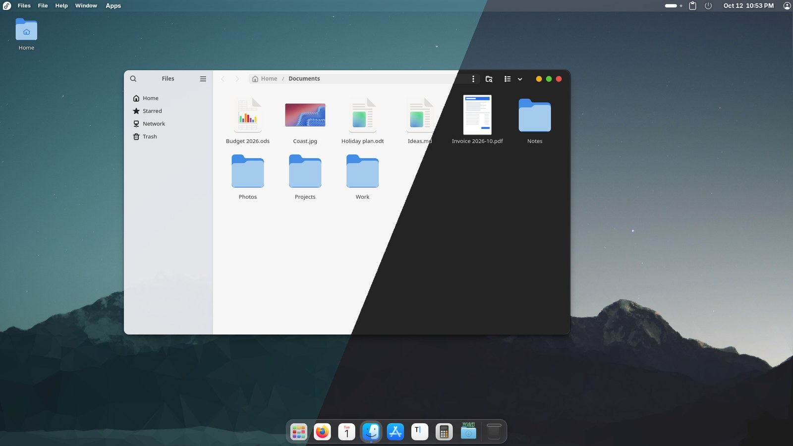
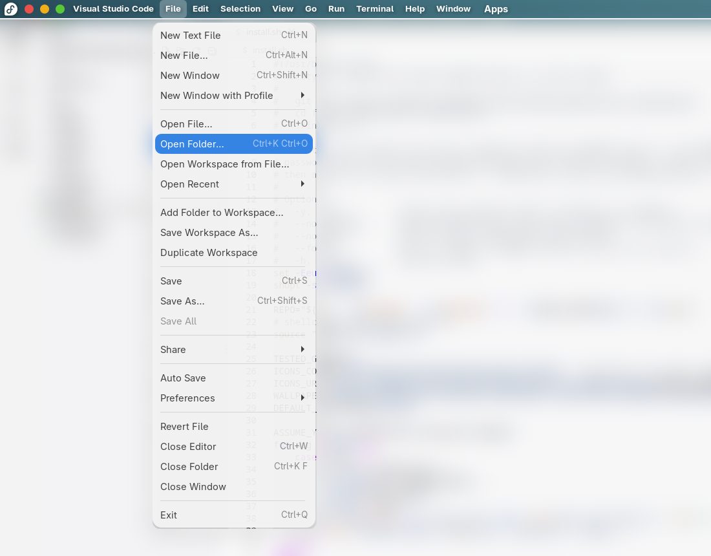
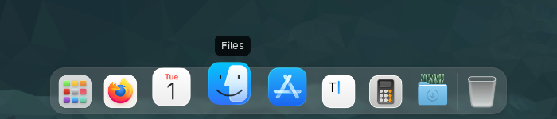
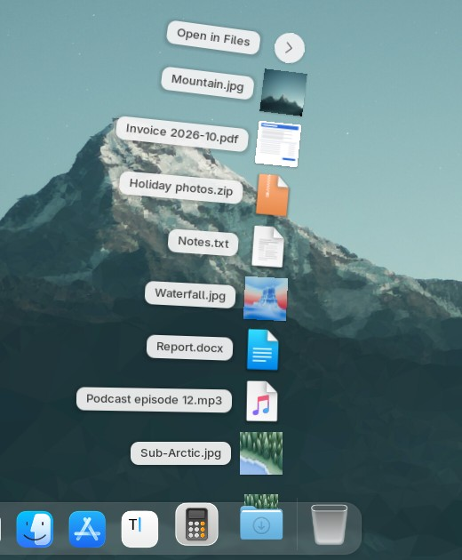
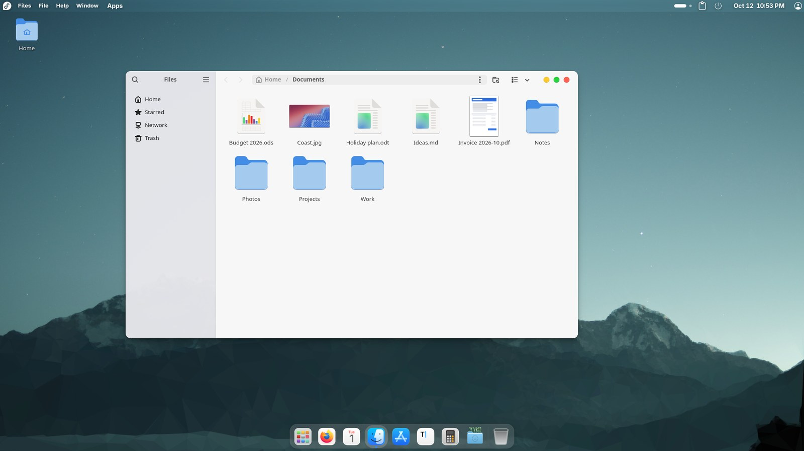
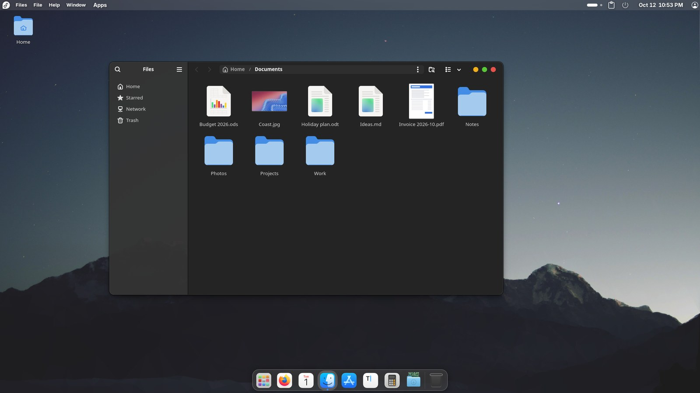
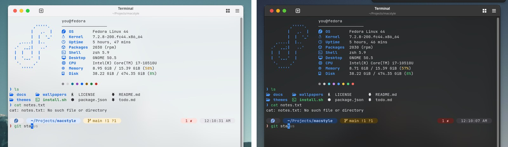
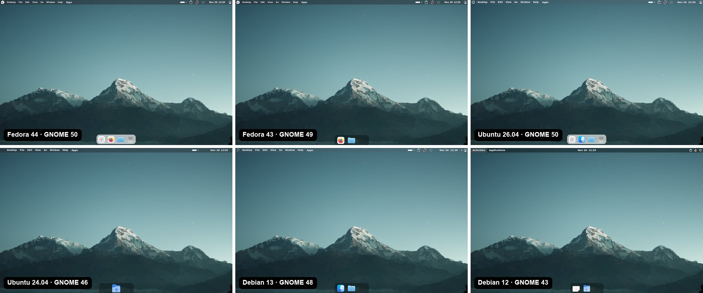

# macstyle

**A macOS-like desktop for Fedora, Ubuntu, Debian and Windows, in one command.**

[](https://github.com/TYFSADIK/macstyle/actions/workflows/test.yml)


[](LICENSE)

Maintained by **Taki Sadik**.



macstyle gives your desktop the macOS features that make daily work easier: a dock, the app's menus in the top bar, window buttons on the left, Quick Look, and a Dark Style that switches everything at once, wallpaper included. Everything it changes is saved first, and one command puts it all back.

## Install

### Linux: Fedora, Ubuntu, Debian

Open a terminal inside your GNOME desktop and run:

```bash
git clone https://github.com/TYFSADIK/macstyle
cd macstyle
./install.sh
```

Then **log out and log back in**: GNOME starts new extensions only at login.

- Type it without `sudo`. It asks for your password itself, once, for a few small packages and a Firefox setting.
- It takes a minute or two. It downloads the MacTahoe icon theme, a terminal font and Powerlevel10k, and on older GNOME versions the extensions and theme made for that version.
- If `git` is missing: `sudo dnf install git` (Fedora) or `sudo apt install git` (Ubuntu, Debian).

| Distribution | GNOME | Notes |
|---|---|---|
| Fedora 44, 45 | 50, 51 | everything, with the bundled, tested extensions |
| Fedora 42, 43 | 48, 49 | extensions from extensions.gnome.org for that version |
| Ubuntu 26.04 LTS, 26.10 | 50, 51 | everything; Ubuntu Dock is switched off |
| Ubuntu 24.04 LTS | 46 | the theme is built for GNOME 46 |
| Debian 13 | 48 | Ptyxis is installed as the terminal (Console cannot be styled) |
| Debian 12 | 43 | no top-bar app menus (AppMenu needs GNOME 45); the theme is built for GNOME 43 |

Any GNOME from 43 up works: for each extension, the install uses the bundled copy if it declares your GNOME version, otherwise downloads the release made for it, and skips it with a message if there is none. Nothing made for another version is ever switched on.

### Windows 10 and 11

Download the repository (**Code > Download ZIP**, then unzip) or clone it, open PowerShell in the folder (not as administrator) and run:

```powershell
powershell -ExecutionPolicy Bypass -File .\windows\install.ps1
```

Then sign out and back in once.

#### For every account on the computer

To give everyone who uses the computer the same look, including people who sign in for the first time later, run this once in PowerShell **as administrator**:

```powershell
powershell -ExecutionPolicy Bypass -File .\windows\allusers.ps1
```

It copies macstyle to `C:\Program Files\macstyle`, sets the folder and drive icons for the whole computer, and adds the scheduled task `\macstyle\macstyle`. That task runs at every sign-in, as the person signing in, and sets macstyle up for them in the background (once per version; the first time it also installs the apps for them). Someone who runs `uninstall.ps1` for themselves is not set up again. Each person's log is `%LOCALAPPDATA%\macstyle-allusers.log`.

`allusers.ps1 -Remove` puts each person back at their next sign-in; once everyone has signed in, `allusers.ps1 -Remove -Purge` deletes the task and the copy in Program Files.

## What you get

### Linux

#### Menus and window buttons in the top bar



- The top bar shows the menus of the app you are using (File, Edit, View...), for VS Code, Chrome, Firefox, LibreOffice and other apps that publish their menus (GNOME 45 and newer).
- Maximize a window and its close, minimize and maximize buttons move into the top bar.
- Window buttons sit on the left, as on a Mac.
- Apps you install later follow too: a small background service sets up every Chromium or Electron app (Chrome, Brave, VS Code, Discord...) when it is installed or updated.

#### A dock that magnifies



Icons grow gently under the pointer, on a translucent dock that steps aside when a window needs the space: Dash2Dock Motion on GNOME 50 and 51, Dash2Dock Lite on GNOME 43 to 49. If neither exists for your GNOME version, Dash to Dock is set up the same way, without magnification.

#### Downloads fan



Click **Downloads** in the dock and your newest files fan out, with thumbnails (GNOME 50 and 51; on older versions the icon opens the folder). Right-click it for *Open Downloads Folder*, *Open Most Recent Download* and *Show Most Recent in Files*.

#### Dark Style switches everything

| Light | Dark |
|---|---|
|  |  |

Turn on **Dark Style** in Quick Settings and apps, top bar, dock, icons, window shadows, the terminal and the wallpaper all follow (each wallpaper has a day and a night picture).

#### A terminal that looks the part



- Each new terminal opens with your distribution's logo and a short system summary.
- The prompt is a row of round pills: the folder, the git branch (green when clean, amber with changes), and on the right the time, an error pill when a command fails, and how long a slow command took.
- Grey suggestions from your history as you type, green and red commands, Ctrl+R history search, `z name` to jump to a folder, `ls` with icons.
- Ptyxis (Fedora, Ubuntu 25.10+, Debian 13) and GNOME Terminal (Ubuntu 24.04) both get the colours, the font and a see-through window, in light and dark.

#### And also

Quick Look (press Space on a file in Files), a blurred translucent top bar and dock, rounded corners on every window, a matching second top bar on a second monitor, Alt+Tab as a cover flow, a "magic lamp" minimize, desktop icons, clipboard history, Caffeine, and six day-and-night wallpaper pairs from KDE in Settings > Appearance.

### Windows

- **A dock and a top bar**, from Seelen UI (open source).
- **Quick Look**: press Space on a file in File Explorer to preview it (QuickLook).
- **Spotlight**: Alt+Space searches apps, files and more (PowerToys).
- **Dark mode on a schedule** with a tray switch (Auto Dark Mode), and **wallpapers that follow it**: the day picture in light mode, the night one in dark mode.
- **macOS icons everywhere Windows allows**: blue folders in File Explorer, Desktop, Documents, Downloads and the other folders with their macOS icons, This PC, Recycle Bin and Network on the desktop, the hard drive, app shortcuts in the Start menu, on the desktop and the taskbar, and the apps in the dock (MacTahoe icons).
- **The macOS cursor**, the **Inter** font (close to SF Pro) and **JetBrains Mono** with icons.
- **The same terminal**: Windows Terminal with the macstyle colours (light and dark), see-through, and PowerShell with the round-pill prompt (Starship), grey suggestions, `z` jumps, `ls` with icons and fastfetch.
- Taskbar icons centred, the macOS blue as accent colour.

Windows cannot move window buttons to the left or put an app's menus in the top bar; macstyle does not pretend to. Icons that apps draw themselves (inside their windows, and Store apps in the taskbar) keep their own look.

## What the install changes

**Linux.** Everything goes into your home folder, except the packages and one Firefox setting: GNOME extensions in `~/.local/share/gnome-shell/extensions`; WhiteSur themes in `~/.themes`; MacTahoe icons and cursor in `~/.local/share/icons`; wallpapers; two small background services (systemd user units: `macstyle-darkswitch` follows Dark Style, `macstyle-appfollow` sets up Chromium and Electron apps); launcher copies so Chromium, Electron apps and Firefox run as X11 apps whose menus reach the top bar; a Firefox default in `/etc/firefox/policies/policies.json` (Debian's Firefox ESR: `/usr/lib/firefox-esr/distribution/policies.json`); for the terminal, two marked blocks in `~/.zshrc` and configs in `~/.config`. Your login shell does not change: the terminal app runs zsh.

Packages: the top-bar menu libraries (libdbusmenu), the Apps Menu extension, Sushi (Quick Look), and for the terminal zsh, zsh-autosuggestions, zsh-syntax-highlighting, fzf, zoxide, fastfetch and lsd (downloaded from their projects where the distribution does not package them). GNOME 47 and older also get `sassc` to build the theme.

**Windows.** Apps with winget, started right away and at every sign-in (a shortcut in your Startup folder for Seelen UI and QuickLook; PowerToys and Auto Dark Mode set that up themselves); fonts for your account only (no administrator); the cursor, wallpaper, accent and taskbar settings in your part of the registry; icons: desktop icons in your part of the registry, a hidden desktop.ini in your own folders, the icon of matching app shortcuts, and an icon pack switched on in Seelen UI; with administrator (asked once, `-NoAdmin` skips it) the icon of every folder and the C: drive and of the shortcuts shared by all users, from `%ProgramData%\macstyle`; a hidden dark-mode watcher started from your Startup folder; a marked block in your PowerShell profiles; a Windows Terminal profile.

Before changing anything, the first run saves your settings and every file it replaces (Linux: `~/.local/state/macstyle/original/`, Windows: `%LOCALAPPDATA%\macstyle\original\`). Running the install again is safe: it keeps that first copy.

### Options

| Linux | Windows | What it does |
|---|---|---|
| `-y`, `--yes` | `-Yes` | Answer every question with its default (no prompts). |
| `--no-packages` | | Skip everything that needs `sudo`. |
| `--no-apps` | `-NoApps` | Linux: leave VS Code, Chrome and Firefox alone. Windows: no dock, top bar, Quick Look, search or dark-mode apps. |
| `--no-terminal` | `-NoTerminal` | Leave the terminal and the shell alone. |
| | `-NoIcons` | Leave all icons alone. |
| | `-NoAdmin` | Skip the step that needs administrator (every folder, the C: drive, shared shortcuts). |
| `--force` | | Run on a distribution that is not Fedora, Ubuntu or Debian. |

## Uninstall

```bash
./uninstall.sh                                                    # Linux
powershell -ExecutionPolicy Bypass -File .\windows\uninstall.ps1  # Windows
```

It brings back the settings and files saved by the first install, removes what the install added and stops the background services. Then log out and back in. On Linux the packages stay installed (they are harmless); on Windows it offers to uninstall the apps it installed (`-KeepApps` keeps them).

## Tested

Every push installs macstyle on Fedora 43 and 44, Ubuntu 24.04 and 26.04, Debian 12 and 13, and Windows Server 2025, in CI ([tests/](tests/)). On Linux it then starts GNOME Shell (headless) and checks that every switched-on extension is running, takes a screenshot, uninstalls, and checks that the settings are back exactly as they were. On Windows it checks the fonts, cursor, wallpaper, dark-mode watcher, PowerShell profiles, prompt and Windows Terminal profile, uninstalls and checks the registry is back.



| | GNOME | Extensions running | Dock |
|---|---|---|---|
| Fedora 44 | 50 | 19 of 19 | Dash2Dock Motion |
| Fedora 43 | 49 | 18 of 18 | Dash2Dock Lite |
| Ubuntu 26.04 | 50 | 18 of 18 | Dash2Dock Motion |
| Ubuntu 24.04 | 46 | 17 of 17 | Dash2Dock Lite |
| Debian 13 | 48 | 17 of 17 | Dash2Dock Lite |
| Debian 12 | 43 | 12 of 12 | Dash2Dock Lite |

Each one uninstalls back to the same settings it started with. The screenshots come from a headless GNOME Shell in a container; they show the top bar and the dock, not a live login with apps open.

## Good to know

- Extensions start only after you log out and back in. An app that is open during the install changes the next time you start it.
- Some apps run as X11 apps (through XWayland) so that their menus can reach the top bar. With X11 apps open, logging out takes about 5 seconds longer (a GNOME issue).
- AppMenu, Multi Monitors Bar, Rounded Window Corners Reborn, Unite and Dash2Dock Motion are bundled with fixes of our own ([patches/](patches/)); extensions.gnome.org does not update them. To get updates, `git pull` and run `./install.sh` again.
- The SF Pro font is not included because of Apple's licence; if you have it, macstyle uses it on Linux.

## Credits and licence

macstyle is built on the work of many people: the authors of the GNOME extensions, the WhiteSur GTK theme and MacTahoe icons by vinceliuice, the KDE wallpaper artists, and on Windows Seelen UI, QuickLook, PowerToys, Auto Dark Mode, Starship and the apple_cursor project. [CREDITS.md](CREDITS.md) lists each one, its licence and what we changed.

macstyle's own code is under the [GNU General Public License 3.0](LICENSE). The bundled parts keep their own licences.
